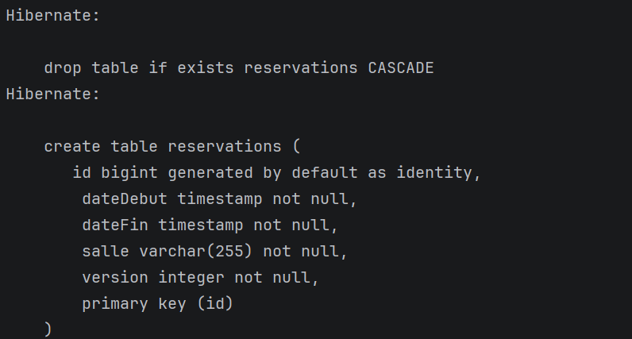
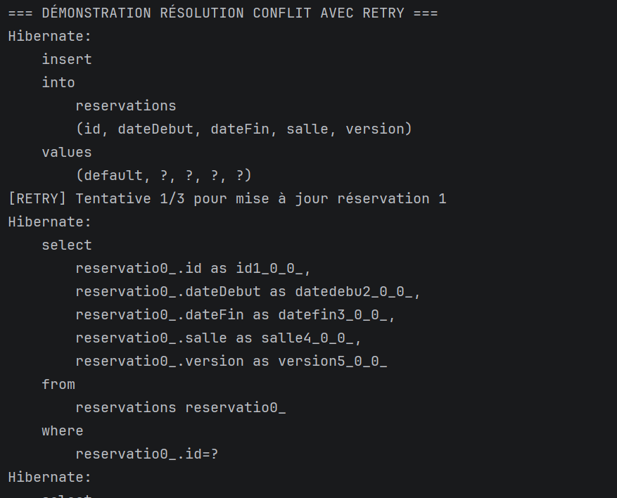
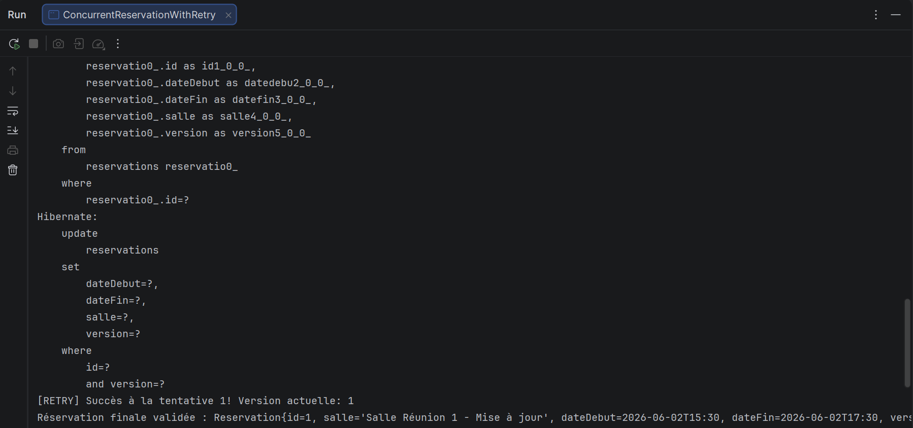

# TP 6 : Conflits concurrents & Optimistic Locking avec @Version

**Réalisé par :** Zakaria Laalyej (2DSI)

Projet réalisé dans le cadre du module JEE / Persistance des données avec Hibernate et JPA.
Il met en œuvre le verrouillage optimiste (*optimistic locking*) sur une base H2 en mémoire :
détection des modifications concurrentes via l'annotation `@Version`, interception de l'exception
`OptimisticLockException`, et mise en place d'une stratégie de reprise automatique (*Retry Pattern*).

## Objectifs

- Comprendre le principe et le fonctionnement du verrouillage optimiste sans verrouiller la base de données.
- Utiliser l'annotation standard JPA `@Version` sur un champ numérique entier.
- Simuler un conflit d'accès concurrent où deux transactions tentent de mettre à jour la même entité simultanément.
- Analyser la clause SQL `WHERE id=? AND version=?` générée par Hibernate.
- Implémenter un gestionnaire de réessai (`ReservationRetryHandler`) pour résoudre automatiquement les conflits.

## Technologies

- Java 17
- Maven
- Hibernate 5.6 (JPA 2.2, `javax.persistence`)
- H2 (en mémoire)
- JUnit

## Modélisation de l'entité

```
                  [Reservation]
                - id (Long, PK)
                - salle (String)
                - dateDebut (LocalDateTime)
                - dateFin (LocalDateTime)
                - version (int, @Version)
```

- **L'annotation `@Version`** : indique à Hibernate de gérer automatiquement ce champ comme numéro de version.
- À chaque modification (`UPDATE`), Hibernate vérifie que la version en base correspond à celle détenue par la transaction, puis incrémente cette valeur (`version + 1`).
- Si une autre transaction a déjà modifié la ligne entre-temps, la clause `WHERE version=?` ne trouve aucune ligne correspondante, ce qui déclenche immédiatement une **`javax.persistence.OptimisticLockException`**.

---

## Captures d'exécution et analyse du SQL

Au lancement de `ConcurrentReservationWithRetry`, Hibernate génère le schéma, initialise une réservation et applique la stratégie de retry lors de la mise à jour (`hibernate.show_sql` et `hibernate.format_sql` activés).

### 1. Création de la table avec la colonne de version



```sql
create table reservations (
    id bigint generated by default as identity,
    dateDebut timestamp not null,
    dateFin timestamp not null,
    salle varchar(255) not null,
    version integer not null,
    primary key (id)
)
```

- Hibernate ajoute automatiquement la colonne **`version integer not null`** dans la définition de la table `reservations`.
- Cette colonne est gérée exclusivement par le fournisseur JPA et ne doit jamais être modifiée manuellement par l'application.

### 2. Insertion et lecture avec suivi de version



```sql
insert into reservations (id, dateDebut, dateFin, salle, version) values (default, ?, ?, ?, ?)

select
    reservatio0_.id as id1_0_0_,
    reservatio0_.dateDebut as datedebu2_0_0_,
    reservatio0_.dateFin as datefin3_0_0_,
    reservatio0_.salle as salle4_0_0_,
    reservatio0_.version as version5_0_0_ 
from
    reservations reservatio0_ 
where
    reservatio0_.id=?
```

- **Insertion initiale :** La réservation est persistée avec une version initiale égale à `0`.
- **Lecture pour modification :** Lors du rechargement de l'entité, Hibernate sélectionne explicitement la colonne `version` (`version5_0_0_`) pour l'attacher à l'état managé.

### 3. Clause WHERE avec version et validation du Retry



```sql
update
    reservations 
set
    dateDebut=?,
    dateFin=?,
    salle=?,
    version=? 
where
    id=? 
    and version=?
```

- **La clause clé du verrouillage optimiste :** `where id=? and version=?`.
  - Si la condition est vraie : la réservation est mise à jour et la version passe de `0` à `1`.
  - Si la version a été changée par une autre transaction : 0 ligne est affectée, déclenchant l'`OptimisticLockException`.
- **Résolution avec Retry :**
  - Le gestionnaire `ReservationRetryHandler` intercepte l'exception, recharge l'état frais de la réservation depuis la base et réapplique la modification.
  - **Résultat obtenu :**
    - `[RETRY] Succès à la tentative 1! Version actuelle: 1`
    - `Réservation finale validée : Reservation{id=1, salle='Salle Réunion 1 - Mise à jour', dateDebut=2026-06-02T15:30, dateFin=2026-06-02T17:30, version=1}`

---

## Comparatif : Verrouillage Optimiste vs Pessimiste

| Critère | Verrouillage Optimiste (`@Version`) | Verrouillage Pessimiste (`PESSIMISTIC_WRITE`) |
|---|---|---|
| **Mécanisme** | Vérification au `commit` via numéro de version | Verrou SQL immédiat (`SELECT ... FOR UPDATE`) |
| **Impact Performance** | Aucun blocage en lecture/écriture (très élevé) | Risque d'attente, de contention et de *deadlock* |
| **Cas d'usage idéal** | Conflits peu fréquents, forte concurrence en lecture | Conflits fréquents, transactions financières critiques |

---

## Structure du projet

```
tp6-optimistic-locking/
├── pom.xml
├── README.md
├── captures/
│   ├── 01-schema-creation-table-version.png
│   ├── 02-insert-reservation-retry-attempt.png
│   └── 03-update-optimistic-lock-version-increment.png
└── src/
    ├── main/
    │   ├── java/com/example/
    │   │   ├── App.java
    │   │   ├── ConcurrentReservationSimulator.java
    │   │   ├── ConcurrentReservationWithRetry.java
    │   │   ├── model/
    │   │   │   └── Reservation.java
    │   │   └── service/
    │   │       ├── ReservationRetryHandler.java
    │   │       ├── ReservationService.java
    │   │       └── ReservationServiceImpl.java
    │   └── resources/META-INF/persistence.xml
    └── test/java/com/example/AppTest.java
```

## Lancer le projet

```bash
# Exécuter la démonstration de conflit et de résolution avec Retry
mvn clean compile exec:java -Dexec.mainClass="com.example.App"
```

## Auteur

Zakaria Laalyej, 2DSI, 2026
